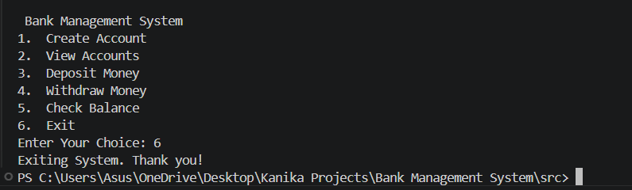

# Bank Management System

A simple console-based Bank Management System built using Python and MySQL.

## Features
- Create a bank account
- View all accounts
- Deposit money
- Withdraw money
- Check account balance

## Technologies Used
- Python
- MySQL
- MySQL Connector

## Installation and Setup
1. Install Python and MySQL Server.
2. Create a database named `bank_system`.
3. Create the `accounts` table with `id`, `name`, `email`, and `balance` columns.
4. Install dependencies:

   ```bash
   pip install -r requirements.txt
   ```

5. Configure your MySQL credentials in `src/db_config.py`.
6. Run the project:

   ```bash
   cd src
   python main.py
   ```


## Screenshots


### Create Account


### View Accounts


### Deposit Money


### Withdraw Money


### Check Balance


### Exit


## Author
Kanika Agarwal